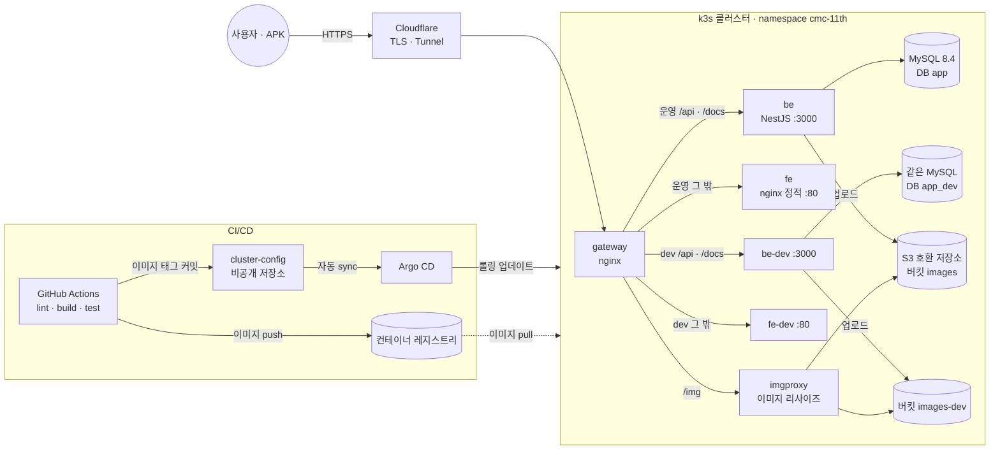
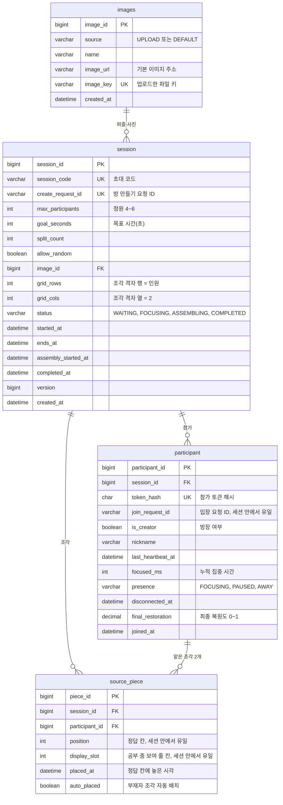

# Pocus 서버

여럿이 함께 공부하는 집중 세션 **Pocus** 의 API 서버입니다. 11th NE(O)RDINARY HACKATHON 5팀.

방장이 사진을 올리고 4~6명을 초대하면 참가자마다 조각 2개를 맡습니다. 얼굴이 카메라에 보이는 동안만 공부 시간이 쌓이고, 시간이 끝나면 조각을 함께 끼워 사진을 완성합니다. 조각은 주인이 집중한 만큼만 선명합니다.

| | 주소 |
|---|---|
| 운영 | https://cmc-11th.bemelon.me |
| dev | https://cmc-11th-dev.bemelon.me |
| API 명세 (Swagger) | https://cmc-11th.bemelon.me/docs |
| 서버 상태와 배포된 커밋 | https://cmc-11th.bemelon.me/api/health |
| 프론트엔드 | [Frontend](https://github.com/Nerdinary-Hackerton20261121-5Team/Frontend) |

## 기술 스택

| 구분 | 사용 기술 |
|---|---|
| 프레임워크 | NestJS 12, TypeScript 6 (ESM) |
| DB | MySQL 8.4, TypeORM (마이그레이션으로만 스키마 변경) |
| 파일 | S3 호환 저장소, imgproxy(리사이즈), sharp(조각 이미지) |
| API 문서 | Swagger (`@nestjs/swagger`) |
| 요청 검증 | class-validator, class-transformer |
| 테스트 | Vitest, Supertest (단위, e2e) |
| 코드 품질 | oxlint, Prettier |
| 배포 | GitHub Actions, Argo CD, k3s |

## API 명세

Swagger에서 요청·응답 예시를 보고 바로 호출할 수 있습니다.

- 로컬: http://localhost:3000/docs
- dev: https://cmc-11th-dev.bemelon.me/docs
- 운영: https://cmc-11th.bemelon.me/docs

**공통 응답 형식**

```json
{ "success": true,  "code": "SUCCESS",       "message": "요청이 성공했습니다.", "data": { } }
{ "success": false, "code": "INVALID_INPUT", "message": "요청 값이 올바르지 않습니다. (...)", "data": null }
```

| HTTP | code | 언제 |
|---|---|---|
| 200 / 201 | `SUCCESS` | 조회·수정 성공 / 생성 성공 |
| 400 | `INVALID_INPUT` | 필수 값 누락, 잘못된 형식, 정의되지 않은 필드, 깨진 JSON |
| 401 | `TOKEN_REQUIRED`, `TOKEN_INVALID` | 참가자 토큰이 없거나 유효하지 않음 |
| 403 | 기능별 코드 | 이 세션의 참가자가 아님, 방장만 할 수 있는 요청 |
| 404 | `NOT_FOUND` 또는 기능별 코드 | 없는 경로, 없는 대상 |
| 409 | 기능별 코드 | 지금 단계에서는 할 수 없는 요청 (이미 시작됨, 공부 중 등) |
| 429 | `TOO_MANY_REQUESTS` | 요청 횟수 제한 초과 |
| 500 | `INTERNAL_ERROR` | 서버 내부 오류 (내부 메시지는 노출하지 않음) |

참가자 토큰이 필요한 API는 `X-Participant-Token` 헤더를 씁니다. Swagger에서는 **Authorize** 버튼에 토큰을 넣으면 됩니다.

### API 목록

| 메서드 | 경로 | 설명 | 토큰 | 성공 | 실패 |
|---|---|---|---|---|---|
| GET | `/api/health` | 서버 상태·배포 커밋 확인 (공통 형식으로 감싸지 않음) | - | 200 | - |
| POST | `/api/images` | 이미지 업로드 (multipart, 필드명 `file`). `imageId` 와 보여주기용·썸네일 주소 반환. 방 사진으로 쓰려면 이어서 방 이미지 지정을 부른다 | O | 201 | 400, 401 |
| POST | `/api/sessions` | 방 만들기 (목표 시간·정원 4~6명). 세션 코드와 개설자 `participantToken` 발급. 같은 `clientRequestId` 재전송은 기존 방 반환 | - | 201 | 400 |
| POST | `/api/sessions/join` | 세션 코드로 입장. 참가자 `participantToken` 발급 | - | 201 | 400, 404, 409(시작됨·정원 참) |
| GET | `/api/sessions/{sessionId}` | 세션 조회 (단계·남은 시간·인원·내 정보·명단 `participants`, `serverNow`) | O | 200 | 400, 401, 403, 404 |
| PATCH | `/api/sessions/{sessionId}/image` | 방 이미지 지정 `{ imageId }` (방장, 시작 전). 업로드한 사진(`POST /api/images`의 `imageId`)이나 기본 이미지. 다시 보내면 바꿈 | O | 200 | 400, 401, 403, 404, 409 |
| PATCH | `/api/sessions/{sessionId}/participants/me` | 닉네임 설정 `{ nickname }` (1~20자). 링크로 입장한 뒤 "참여하기"에서 호출. 명단은 세션 조회 `participants`(입장 순서·닉네임·방장 여부) | O | 200 | 400, 401, 403, 404 |
| DELETE | `/api/sessions/{sessionId}/participants/me` | 대기실 나가기 (시작 전). 내 참가자 정보 삭제 → 토큰 무효·자리 비움. 방장이 나가면 다음 입장 순서가 방장, 마지막 한 명이면 방 삭제 | O | 200 | 400, 401, 403(다른 세션), 404, 409(시작됨) |
| POST | `/api/sessions/{sessionId}/start` | 세션 시작 (개설자, **최소 4명**). 명단 고정, 시작·종료 시각 확정, 원조각(한 행 2명)·조립 조각(원조각당 4개) 생성. 다시 보내면 처음 결과 반환 | O | 200 | 400(인원 부족 포함), 401, 403, 404 |
| POST | `/api/sessions/{sessionId}/end` | 공부 조기 종료 (방장). 종료 시각을 지금으로 당겨 모두 조립 단계로. 복원도는 원래 목표 기준. 재전송은 처음 결과 | O | 200 | 400, 401, 403, 404, 409(시작 전) |
| POST | `/api/sessions/{sessionId}/heartbeat` | 연결 확인·상태 보고 `{ state?: FOCUSING \| PAUSED \| AWAY }` (주기적으로 + 상태가 바뀔 때 바로). 직전 상태가 `FOCUSING`(얼굴 인식)인 구간만 누적, 일시정지·얼굴 미인식·끊김(기본 90초) 구간은 제외. 복원도 = 누적 집중 시간 / 목표 시간 | O | 200 | 400, 401, 403, 404 |
| GET | `/api/sessions/{sessionId}/board` | 진행판 (조각 위치·모양·모두의 복원도, 함께 하는 사람 명단 `members`: 상태 `FOCUSING\|PAUSED\|AWAY\|DISCONNECTED`·누적 집중 시간). 남의 조각 이미지는 복원도에 따라 블러 | O | 200 | 400, 401, 403, 404 |
| GET | `/api/sessions/{sessionId}/result` | 공부 결과 (공부 시간 종료 후). 참가자별 누적 집중 시간·집중 못 한 시간·최종 복원도·부재 여부, 팀 평균 복원도 | O | 200 | 400, 401, 403, 404, 409(공부 중) |
| GET | `/api/sessions/{sessionId}/pieces/{position}/image` | 조각 이미지 (직소 모양 투명 WebP). 내 조각은 선명, 남의 조각은 주인 복원도에 따라 블러 | O | 200 | 400, 401, 403, 404 |
| GET | `/api/sessions/{sessionId}/assembly` | 조립판 조회. 집중 종료 후 첫 호출에 조립을 열고(최종 복원도 확정, 부재자 조각 자동 배치), 칸 배치(`slots`)·조각 목록 반환. 놓이기 전 정답 위치는 숨김 | O | 200 | 400, 401, 403, 404, 409(집중 중) |
| PATCH | `/api/sessions/{sessionId}/assembly/pieces/{pieceId}` | 조각 놓기 `{ targetPosition }`. 자기 조각만, 정답 칸이면 저장(`correct: true`), 틀린·찬 칸이면 저장 안 함(직전 위치로 복귀). 모두 놓이면 팀 통과(`COMPLETED`) | O | 200 | 400, 401, 403, 404, 409 |
| DELETE | `/api/sessions/{sessionId}` | 방 종료·폐기 (개설자). 세션·참가자·조각 전부 삭제, 이후 토큰 무효 | O | 200 | 400, 401, 403, 404 |

## 인프라 구성도

운영과 dev 가 같은 클러스터의 서로 다른 앱으로 떠 있다. 외부에서 들어오는 길은 Cloudflare Tunnel 하나이고, 서버에 열린 인바운드 포트는 없다.



| 구성 | 내용 |
|---|---|
| WAS 와 DB 분리 | `be`(NestJS)와 MySQL 은 서로 다른 파드다. DB 는 클러스터 안에서만 `mysql:3306` 으로 접근하고 Service 는 ClusterIP 다 |
| 파일 업로드 | 원본은 S3 호환 저장소에 두고, 화면에는 imgproxy 가 줄인 이미지를 `/img/...` 로 내려준다. 운영과 dev 는 버킷이 다르다 |
| HTTPS | Cloudflare 가 TLS 를 끝낸다. `http://` 요청은 301 로 `https://` 로 보낸다 |
| 포트 | 외부 노출은 Cloudflare Tunnel 뿐이라 서버에 열린 인바운드 포트가 없다. DB 포트는 인터넷에 열려 있지 않다 |
| 비밀값 | DB 비밀번호와 저장소 키는 클러스터 Secret 으로 주입한다. 코드와 이 저장소에는 값이 없다(`.env.example` 은 이름만) |
| CI/CD | `dev` 머지 → dev 서버, `main` 머지 → 운영. GitHub Actions 가 이미지를 올리고 태그를 커밋하면 Argo CD 가 반영한다(1~3분) |
| 운영과 dev 분리 | 주소, 파드, DB, 버킷, 환경변수(`be-env` · `be-dev-env`)가 모두 따로다 |

## ERD

테이블은 4개다. 로그인이 없어 사용자 테이블은 없고, 참가자는 방에 들어올 때 받은 토큰(해시로 저장)으로 구분한다. 스키마는 `src/database/migrations` 의 마이그레이션으로만 바뀐다.



방(`session`)을 지우면 참가자와 조각이 함께 지워진다(`ON DELETE CASCADE`).

## 프로젝트 구조

```
src/
├── main.ts          앱 시작점: 전역 설정, Swagger, CORS
├── app.module.ts    루트 모듈
├── common/          전역 예외 필터, 공통 응답 인터셉터, Swagger 데코레이터
├── config/          환경변수와 정책 값 (policy.ts)
├── database/        TypeORM 설정, 마이그레이션
├── auth/            참가자 토큰 가드
├── sessions/        방 만들기, 입장, 조회, 시작, 종료, 닉네임
├── study/           heartbeat, 진행판, 결과, 조각 이미지
├── puzzle/          조각 나누기, 직소 모양, 블러
├── assembly/        조립판, 조각 놓기
├── storage/         이미지 업로드
├── cleanup/         끝난 방 자동 정리
├── throttle/        요청 횟수 제한
└── health/          GET /api/health
test/                e2e 테스트
```

기능마다 controller, service, dto, entities 로 나눕니다.

## 주요 설계

- **공통 응답과 전역 예외 처리**. 모든 응답은 `{ success, code, message, data }` 입니다. 예외는 필터 한 곳에서 이 형식으로 바꾸고, 정의하지 않은 예외는 내부 메시지를 숨긴 500 으로 돌려줍니다.
- **요청 검증**. 본문은 DTO 로 검증하고, 정의하지 않은 필드가 오면 400 으로 거부합니다.
- **로그인 없는 참가자 토큰**. 방을 만들거나 들어올 때 토큰을 발급하고 DB 에는 해시만 둡니다. 같은 요청 ID 로 다시 보내면 새로 만들지 않고 처음 결과를 돌려줍니다.
- **서버 시각 기준 집중 시간**. heartbeat 사이의 시간을 서버 시각으로 재서, 직전 상태가 집중(`FOCUSING`)이던 구간만 쌓습니다. 주기와 무관하게 같은 값이 나옵니다.
- **조회 시점 계산**. 단계(대기, 공부, 조립, 완성)와 복원도는 스케줄러 없이 조회할 때 계산하고, 동시 요청에는 조건부 갱신으로 대응합니다.
- **조각 이미지**. 직소 모양으로 오린 조각을 주인의 복원도에 따라 흐리게 내려 줍니다. 원본은 내려 주지 않습니다.
- **정책 값 외부화**. 목표 시간 범위, heartbeat 주기, 자동 정리 시간, 요청 제한은 `POLICY_*` 환경변수로 바꿉니다.

## 실행 방법

```bash
npm install
cp .env.example .env     # DB_* 를 채운다
npm run migration:run    # 테이블 생성
npm run start:dev        # http://localhost:3000/api, 문서는 /docs
```

| 명령어 | 설명 |
|---|---|
| `npm run start:dev` | 개발 서버 |
| `npm run build` | 빌드 |
| `npm test` | 단위 테스트 |
| `npm run test:e2e` | e2e 테스트 |
| `npm run lint` | 린트 |
| `npm run migration:run` | 마이그레이션 적용 (앱 시작 때 자동으로 돌지 않음) |

환경변수는 `.env.example` 에 이름과 설명이 있습니다. 운영과 dev 의 값은 클러스터가 주입하고, 비밀번호와 키는 이 저장소에 없습니다.

| 이름 | 내용 |
|---|---|
| `PORT`, `CORS_ORIGIN` | 서버 포트, 허용할 프론트 주소 |
| `DB_*` | MySQL 접속 정보 |
| `S3_*`, `IMGPROXY_*` | 파일 저장소와 이미지 변환 서버. 로컬에서 비우면 메모리로 대신함 |
| `POLICY_*` | 제품 정책 값 (`src/config/policy.ts`) |

## 배포

`dev` 에 머지하면 dev 서버에, `main` 에 머지하면 운영에 자동으로 배포됩니다. 운영에는 dev 서버에서 확인한 뒤 `dev` → `main` PR 로 올립니다.

```
dev 또는 main 머지
  └─ GitHub Actions (.github/workflows/deploy.yml)
       ├─ Docker 이미지(linux/amd64) 빌드 후 레지스트리에 push
       └─ 배포 설정 저장소에 새 이미지 태그를 커밋
Argo CD 가 그 커밋을 감지해 롤링 업데이트 (1~3분)
```

- PR 에서는 `CI`(lint, build, test)만 돌고 배포는 일어나지 않습니다.
- 스키마가 바뀌는 변경은 머지 전에 해당 DB 에 마이그레이션을 먼저 적용합니다.
- 게이트웨이가 `/api/*` 와 `/docs*` 를 이 서버로 보냅니다. 그래서 `main.ts` 의 `setGlobalPrefix('api')` 를 지우면 안 됩니다.
- 롤백은 배포 설정 저장소의 해당 `deploy(be)` 커밋을 되돌립니다. 코드는 별도 PR 로 고칩니다.
- 기여 규칙은 [AGENTS.md](AGENTS.md) 에 있습니다.

## 팀

| 이름 | 역할 |
|---|---|
| 황규도 | 백엔드 |
| 이건하 | 백엔드 |
